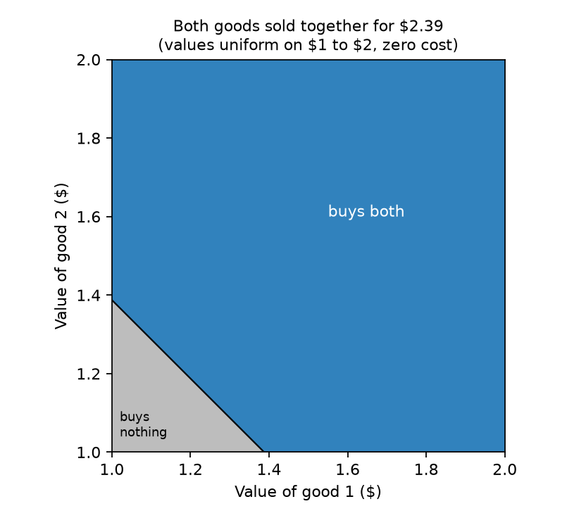
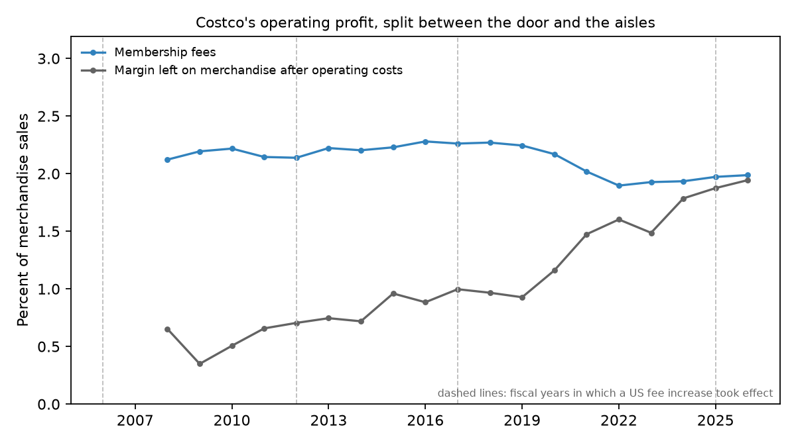
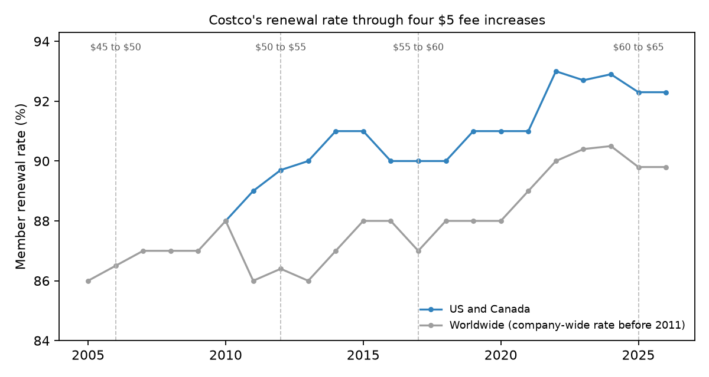

# The Price of Admission

### In 1996, Mark Armstrong proved that a seller of many products will always price some customers out entirely. I asked whether America's warehouse clubs sell the way his theory says they should.

---

A basic Costco membership in the United States costs $65 a year. The card gets you through the door, and once
inside you pay prices that sit, across everything Costco sold in fiscal 2026, about 12.5% above what the goods
cost Costco to buy. That year Costco collected $5.9 billion in membership fees from 84.1 million paid members,
and the fees by themselves came to 51% of its operating income. BJ's Wholesale Club and PriceSmart sell on the
same plan, and so does Sam's Club, which belongs to Walmart.

The plan looks like a retail habit, but it is also an answer to a hard problem in economics. A store that sells
thousands of products to millions of people cannot see what any one of them would pay for any one thing. Some
shoppers buy diapers by the case and never visit the wine aisle. Others come for tires once every few years. In
1996 an economist named Mark Armstrong worked out what a seller facing that kind of variety should do, and one of
his conclusions was uncomfortable. The most profitable price list always leaves some customers out, including
customers who would gladly pay more than the goods cost to supply.

---

## Why a seller turns buyers away

Economists call a price list in which what you pay depends on what else you buy a nonlinear tariff. A phone plan
with a monthly charge and included data is one, and so is a warehouse-club card. The simplest version for a store
with many products is an entry fee $`F`$ plus a price on each item set as a fixed markup $`m`$ over its cost
$`c_j`$, so that a member who buys quantities $`q_j`$ pays

```math
T(q) = F + (1+m)\sum_{j} c_j\, q_j .
```

Armstrong called a tariff of this kind cost-based, because the bill depends on the basket only through what the
basket cost the store. Two measures from a retailer's accounts show how close a real store comes to it. The first
is the markup of merchandise sales $`S`$ over the cost of the goods sold $`C`$. The second is the share of
operating income $`\Pi`$ that comes from total fee revenue $`R`$ rather than from goods. For Costco in fiscal 2026,
in millions of dollars,

```math
m = \frac{S - C}{C} = \frac{297{,}247 - 264{,}279}{264{,}279} = 12.5\%,
\qquad
\frac{R}{\Pi} = \frac{5{,}907}{11{,}685} = 50.6\% .
```

The reason a seller would charge at the door and turn some people away shows up in the smallest example. Take
two goods that cost nothing to supply, two apps, say. Each buyer values each app at somewhere between $1 and $2,
spread evenly, and her two values are unrelated. A seller with one app would charge $1 and sell to everyone. A seller of both can do the same by charging $2 for the
pair. Armstrong's argument asks what happens when the price goes up a little.

| Price increase | One app: buyers lost | One app: revenue per buyer | Two apps: buyers lost | Two apps: revenue per buyer |
|---|---|---|---|---|
| 5 cents | 5.0% | $0.998 | 0.12% | $2.047 |
| 10 cents | 10.0% | $0.990 | 0.50% | $2.090 |
| 20 cents | 20.0% | $0.960 | 1.99% | $2.156 |

With one app, a 10-cent increase drives away everyone whose value lies between $1.00 and $1.10, which is a tenth of
all buyers, and revenue falls. With two apps, the only buyers who leave are those whose two values add up to less
than $2.10, a small triangle in the corner of the square of possible tastes, 0.5% of buyers, and revenue rises. The
seller keeps raising the price until the gain and the loss balance, which here happens at $2.39 for the pair. At
that price 7.5% of buyers buy nothing, every one of whom values each app above its cost of zero, and revenue per
potential buyer is $2.21 instead of $2.00.



The same thing happens when tastes start at zero. With each value spread evenly between 0 and 1, Alejandro Manelli
and Daniel Vincent showed in 2006 that the best menu sells either good for 2/3 or both for (4 − √2)/3, about 0.86.
On my grid of buyer types that menu turns away one buyer in three, against one in four when each good is sold for
1/2, and earns 0.549 per buyer against 0.500. When tastes are unrelated from product to product, the excluded
corner thins out as products multiply, because a buyer lukewarm about one item is usually keen on another. In my
simulation of the app example with more goods, 200,000 simulated buyers per case, the share left out by the best bundle price falls from 7.7% with two goods (7.5% in the exact calculation) to 3.0% with ten and 0.6% with a hundred. A store with thousands of
products should leave out mainly the buyers who would buy little of anything.

---

## Mark Armstrong's question

Mark Armstrong was born in 1964, read mathematics at Queens' College, Cambridge, and wrote his doctorate at Oxford
under James Mirrlees, who shared the 1996 Nobel prize in economics with William Vickrey for work on incentives when
one side of a bargain knows something the other does not. When "Multiproduct Nonlinear Pricing" appeared in
*Econometrica* in January 1996, Armstrong was the Eric Roll Professor of Economic Policy at the University of
Southampton. Two years earlier he had published, with Simon Cowan and John Vickers, a book on regulating Britain's
privatized telephone, gas, electricity and water companies, industries that live on complicated tariffs. He moved
to Nuffield College, Oxford, in 1997, to University College London in 2003, to All Souls College, Oxford, in 2011,
and back to UCL in 2022, and was elected a Fellow of the British Academy in 2007.

The paper's abstract opens by naming what it changed. Nearly all earlier theory assumed that everything a seller
does not know about a buyer could be summed up in one number. Armstrong let buyers differ in several directions at
once. He proved that the seller will always choose to exclude some low-value buyers from every market, and found a
family of cases he could solve exactly in which the best tariff is cost-based. Two years later Jean-Charles Rochet
and Philippe Choné showed in the same journal that the general problem has a second feature one-dimensional models
rule out. Buyers with different tastes are routinely "bunched" onto the same option, because tailoring a separate
deal to each costs the seller more than it gains.

The core of the exclusion result fits in a few lines. Suppose goods cost nothing, the seller charges a price
$`p`$ at which every buyer buys, and $`G(\varepsilon)`$ is the share of buyers whose surplus at that price is less
than $`\varepsilon`$. Raising the price by $`\varepsilon`$ changes profit per potential buyer by

```math
\begin{aligned}
\Delta\pi &= (p+\varepsilon)\,[1-G(\varepsilon)] - p \\
&= \varepsilon - (p+\varepsilon)\,G(\varepsilon) \\
\text{one good: } G(\varepsilon) \approx f\varepsilon &\;\Rightarrow\; \Delta\pi \approx \varepsilon\,(1 - p f) \\
\text{two goods: } G(\varepsilon) \approx \tfrac{1}{2} f_2\,\varepsilon^{2} &\;\Rightarrow\; \Delta\pi \approx \varepsilon > 0
\end{aligned}
```

where $`f`$ is the density of buyers at the bottom of a single taste and $`f_2`$ the density in the corner of two.
With one good the sign depends on how crowded the bottom is, so serving everyone can be optimal. With two or more,
the buyers at the margin sit in a corner whose size shrinks like $`\varepsilon^2`$, so a small increase always
pays and some buyers are always left out. In the app example $`p = 2`$ and $`f_2 = 1`$, so a 10-cent increase gives
$`0.1 - 2.1 \times 0.005 = 0.0895`$, the 9 cents in the table.

In a 2015 survey Armstrong spelled out the many-product case. If a buyer's tastes vary at random across thousands of
items, an entry fee plus prices equal to cost comes close to the most a seller could ever earn, since the luck
averages out and the fee captures each buyer's total gain. When buyers also differ systematically, the fee leaves
the least keen outside. And when sellers compete for shoppers who buy everything in one place, Armstrong and Vickers
showed in 2001 that a fee with prices at cost can be the competitive outcome too.

The strongest objection is that this is a theory about one seller with a free hand, and almost no real seller has
one. Rivals cap any entry fee, and a shopper left out by Costco is rarely left out of anything. The exact
predictions are also hard to pin down. Manelli and Vincent showed that even with two goods the best menu can be
complicated, and Constantinos Daskalakis, Alan Deckelbaum and Christos Tzamos needed a new duality theory in 2017 to
characterize it. What survives as a testable claim is the shape the results point to, an entry fee, unit prices
close to cost, a short menu, and some buyers deliberately left outside.

---

## How I tested it

Armstrong's paper has no data, so the test is whether real sellers in his situation price the way he says. I chose
American warehouse clubs, large retailers that charge an explicit entry fee for access to a few thousand products,
and compared them with five large retailers that let anyone in, namely Walmart, Target, Kroger, Albertsons
and Dollar General. The financial figures come from the machine-readable data filed with each company's annual
report to the Securities and Exchange Commission, fiscal 2021 to 2025. For company $`i`$ in year $`t`$ I estimate

```math
y_{it} = \alpha + \beta\,\text{Club}_i + \lambda_t + e_{it},
\qquad H_0:\ \beta = 0,
```

where $`y_{it}`$ is the markup over the cost of goods, operating costs per dollar of sales, or the margin left on
merchandise after those costs, $`\text{Club}_i`$ marks Costco, BJ's and PriceSmart, $`\lambda_t`$ is a year
effect and $`e_{it}`$ an error term. Standard errors are clustered by company. With only eight companies those are a rough guide, so I also
report an exact permutation test that recomputes $`\hat\beta`$ for all 56 ways of calling three of the eight
companies clubs.

I then read every Costco annual report from fiscal 2005 to 2026 for what the financial data does not carry, the
number of paid members, the split between basic and Executive members, their share of sales and the renewal rate,
and set paid memberships against the Census Bureau's count of American households. The extension uses Costco's
four $5 increases in its US fee. Costco first reported a US and Canada renewal rate in fiscal 2010, so the regression covers the last three
increases. For the change in that rate $`\Delta r_t`$ from fiscal 2011 to 2026 I estimate

```math
\Delta r_t = \alpha + \delta\,\text{Inc}_t + u_t, \qquad H_0:\ \delta = 0,
```

where $`\text{Inc}_t`$ marks an increase year or the year after it and $`u_t`$ is an error term, with
heteroskedasticity-robust standard errors
and a permutation test. I also set the extra fee revenue Costco reported for each increase against the most it
could have cost in lost members.

---

## Warehouse clubs sell close to cost and earn at the door

| Retailer | Entry fee | Markup over cost of goods | Operating costs per $ of sales | Margin left on merchandise | Fees as share of operating income |
|---|---|---|---|---|---|
| Costco | yes | 12.2% | 9.2% | 1.7% | 54% |
| BJ's Wholesale | yes | 19.7% | 14.8% | 1.7% | 57% |
| PriceSmart | yes | 19.0% | 13.1% | 2.8% | 35% |
| Kroger | no | 28.8% | 20.1% | 2.2% | none |
| Walmart | no | 32.8% | 20.6% | 4.1% | none |
| Target | no | 37.9% | 22.0% | 5.5% | none |
| Albertsons | no | 38.7% | 25.6% | 2.3% | none |
| Dollar General | no | 44.2% | 24.0% | 6.7% | none |

*Fiscal 2021 to 2025 totals; PriceSmart covers 2021 to 2024. Percentages of merchandise sales, which exclude fees.*

The clubs mark goods up by 12% to 20% over cost, against 29% to 44% at stores that let anyone in. Most of the gap is
the cost of running the store. Costco spends 9 cents of each sales dollar on wages, rent and everything else, less
than half what Walmart or Kroger spends. In the regression with year effects,

```math
\begin{aligned}
\text{markup: } \hat\beta &= -19.7 \;(3.6),\quad 95\%\ \text{CI}\ [-26.8,\ -12.6], \\
&\qquad p_{\text{perm}} = 0.018,\quad N = 39 \\
\text{margin left: } \hat\beta &= -2.3 \;(0.9),\quad 95\%\ \text{CI}\ [-4.1,\ -0.4], \\
&\qquad p_{\text{perm}} = 0.125,\quad N = 39
\end{aligned}
```

The markup gap is as extreme as any labeling of the eight companies could produce. The gap in what is left on
merchandise after operating costs, 2.3 cents per dollar, is less certain, because Kroger and Albertsons earn about as
little per dollar as the clubs. The fee then carries a large share of the profit, more than half at Costco and BJ's
and about a third at PriceSmart, adding roughly two cents on every dollar of goods that no fee-free retailer
collects. This is the shape Armstrong's results describe, though not the pure form, since Costco's goods are not
sold at cost.

---

## Costco has moved part of its profit back into the aisles



In fiscal 2008, membership fees made up 76% of Costco's operating income, and in the recession year of 2009 they
made up 86%, when the merchandise itself earned 35 cents per $100 of sales after operating costs. Since then the fee
has stayed near 2% of sales while the margin on merchandise has climbed to 1.9%, so by fiscal 2026 the fee's share
of operating income had fallen to 51%. The US fee rose from $50 to $65 over the period, but in 2025 dollars it fell
from $80 in 2006 to $65. The data cannot say why the merchandise margin rose. Inflation, gasoline and the growth of
online sales all move it. What the series shows is that Costco's tariff was closest to Armstrong's cost-based form
fifteen years ago and that the company now earns about equally at the door and in the aisles.

---

## Two lines on the menu sort 84 million members by how much they buy

Rochet and Choné's bunching result predicts that a seller facing endlessly varied buyers will offer only a few
options. Costco's US menu has two lines for households.

| Membership | Annual fee | Members, fiscal 2026 | Share of Costco's sales | Sales per member |
|---|---|---|---|---|
| Executive | $130, with a 2% reward on purchases | 42.3 million | 75.2% | $5,284 |
| Gold Star and Business | $65 | 41.8 million | 24.8% | $1,764 |

The extra fee pays for itself through the reward once a member's spending $`s`$ reaches the break-even point,

```math
0.02\, s^{*} = 130 - 65 \;\Rightarrow\; s^{*} = \frac{65}{0.02} = \$3{,}250 .
```

Members who choose Executive spend three times as much as those who do not and account for three quarters of sales,
up from 45% in 2006. The menu does what screening theory says a menu should do, letting each household reveal its
appetite and charging large buyers a higher fee for a lower price per unit, with tens of millions of baskets
collapsed onto two contracts.

The other prediction is that some households stay outside. Costco does not report members by country, so the data
can only bound the number. In fiscal 2025 Costco had 81.0 million paid memberships worldwide, including businesses and
members abroad, and there were 134.8 million American households. Even if every membership belonged to a different
American household, 39.9% would hold none. In 2006 the same bound was 80.3%.

---

## Costco's $5 fee increases cost it almost no renewals

| US fee increase | Renewal rate before | Lowest rate in next two years | Most members lost | Most revenue lost | Extra fee revenue Costco reported |
|---|---|---|---|---|---|
| $45 to $50 (fiscal 2006) | 86.0% | 86.5% | none | none | not reported |
| $50 to $55 (fiscal 2012) | 89.0% | 89.7% | none | none | $119 million |
| $55 to $60 (fiscal 2017) | 90.0% | 90.0% | none | none | $178 million |
| $60 to $65 (fiscal 2025) | 92.9% | 92.3% | 457,000 | $56 million | $198 million |

*US and Canada renewal rates from fiscal 2010; before that Costco reported one rate without saying which countries it covered. Reported revenue is for the first full year;
for 2025 it is Costco's statement that the increase made up about 40% of that year's growth in fee revenue.*

The first three increases left no mark on the renewal rate. After the 2024 increase the rate slipped six tenths of a
point. Treating every one of those members as driven out by the increase, and charging each the new fee plus
Costco's average margin of $58.49 on a member's purchases, the most the increase could have cost through lost renewals is

```math
0.006 \times 76.2\ \text{million} \times (\$65 + \$58.49) = \$56\ \text{million},
```

under a third of the $198 million gain. Costco itself attributed the dip to members who joined online through
digital promotions and renew at a slightly lower rate. Across the sixteen yearly changes from fiscal 2011 to 2026, the renewal regression gives

```math
\begin{aligned}
\hat\delta &= -0.32 \;(0.32),\quad 95\%\ \text{CI}\ [-0.96,\ 0.31], \\
&\qquad p_{\text{perm}} = 0.44,\quad N = 16 ,
\end{aligned}
```

no detectable effect of an increase on renewals.



This is Armstrong's argument in its plainest form. A $5 increase collected roughly $5 from tens of millions of
members and lost so few at the bottom that the loss cannot be told apart from year-to-year noise. It also suggests
the fee has sat below what a seller with a free hand would choose, which is what one would expect from a company
facing rivals and guarding a reputation for value.

---

## Why it matters

For consumers, the warehouse-club model is a good deal for heavy users and no deal for others. The average Executive
member spends $5,284 a year, pays a $130 fee, and buys goods marked up about 12% over cost. A household that would
spend a few hundred dollars has little reason to join, and Armstrong's theory says that is part of the design.

For smaller retailers and their shoppers, the lowest unit prices in the country are reserved for those who can pay
up front, store bulk quantities and drive to a warehouse. Households outside that system shop where goods are marked
up 29% to 44% instead of 12% to 20%, though most of that gap pays for the costlier way those stores are run.

For policy, a seller can leave people out without market power in the usual sense. Costco faces BJ's, Sam's Club,
Walmart and every supermarket, and still sets a fee that a large part of the country does not pay. The same
logic applies to any service that sells access to many products for one subscription, and a regulator should not
read a fee that prices out some buyers, on its own, as a sign of monopoly.

---

## Limits of this study

Accounting costs are not the costs of one more sale that the theory is written in. Costco's cost of goods includes
some handling and distribution while Kroger's excludes depreciation, so the markups compare only roughly. Walmart's
figures include Sam's Club, whose fees I could not separate. Costco's membership counts changed definition over time,
and since its fiscal 2025 report they include memberships that expired within the previous twelve months. The exclusion figure is a bound, not a
measurement. The fee test has four events, and the renewal rate is a trailing figure covering renewals seven to
eighteen months earlier, so a small effect could fall outside the years I counted, and the worst-case loss counts only members who failed
to renew, not people the higher fee kept from joining. Several SEC documents came from
the Internet Archive's copies of the same sec.gov addresses because SEC was refusing automated requests at the time,
and PriceSmart's last two years were available from neither. Nothing here shows Costco set its fee by Armstrong's
formula, only that its tariff has the shape his theory predicts and that its fee increases behaved as his argument
says they should.

---

## Further reading

- [TECHNICAL.md](TECHNICAL.md) covers the data, method, full results and how to reproduce them.
- [results/FINDINGS.md](results/FINDINGS.md) summarizes the results and lists every table the scripts produce.
- [METHODS_REVIEW.md](METHODS_REVIEW.md) reviews the methods and reported results of the original papers.
- The original paper is Mark Armstrong, "Multiproduct Nonlinear Pricing," *Econometrica* 64(1), 1996, pp. 51–75,
  read with Jean-Charles Rochet and Philippe Choné, "Ironing, Sweeping, and Multidimensional Screening,"
  *Econometrica* 66(4), 1998, pp. 783–826. Armstrong's survey "Nonlinear Pricing" (2015) is free on the Munich
  Personal RePEc Archive.
- Company financial data comes from the XBRL files attached to each company's 10-K on SEC EDGAR, and Costco's
  membership facts from the text of its 10-K reports, fiscal 2005 to 2026. The filings are listed in
  `data/raw/sec_filings.csv`.
- US household counts are the Census Bureau series TTLHH and consumer prices the BLS series CPIAUCSL, both from FRED.

*Brendyn Beasley*
